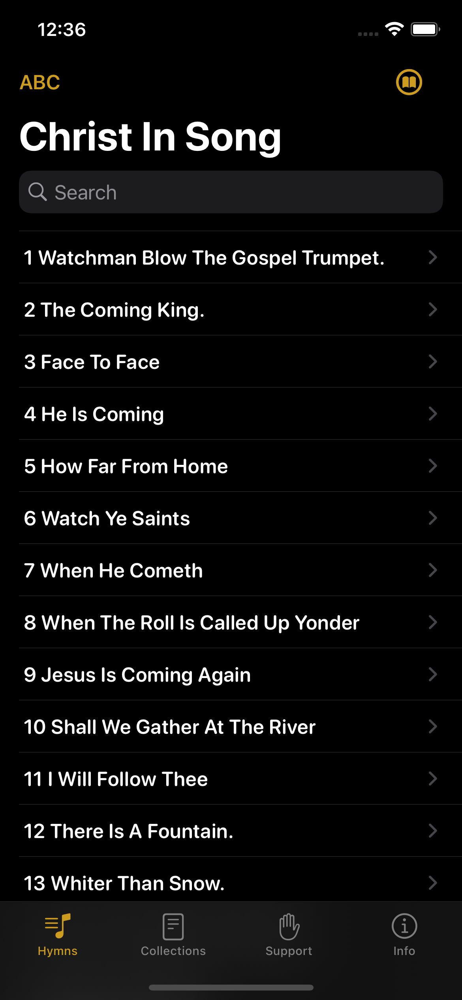
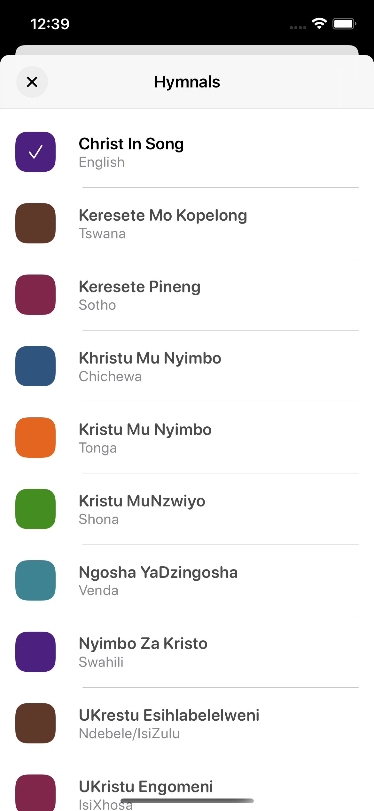
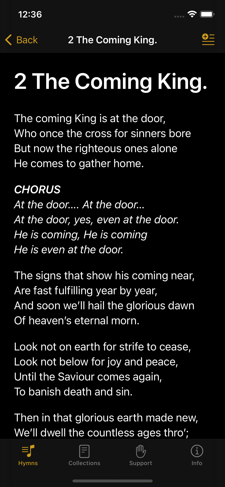
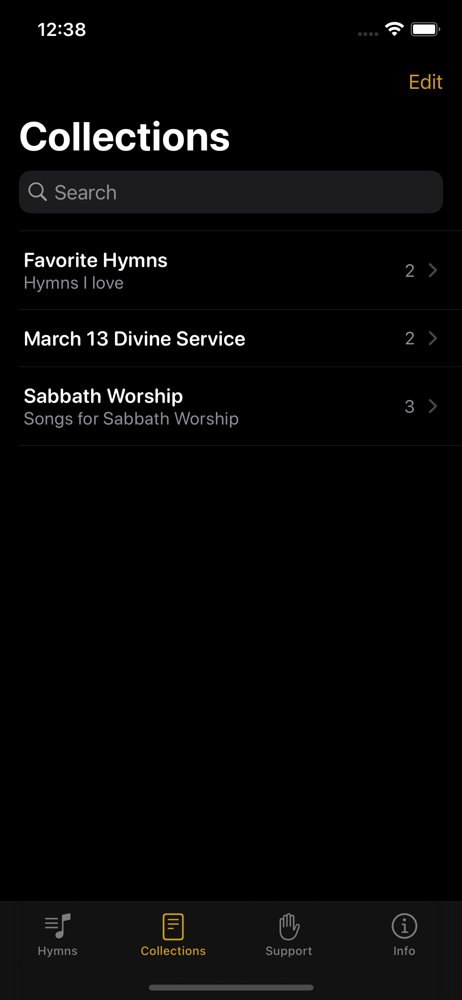
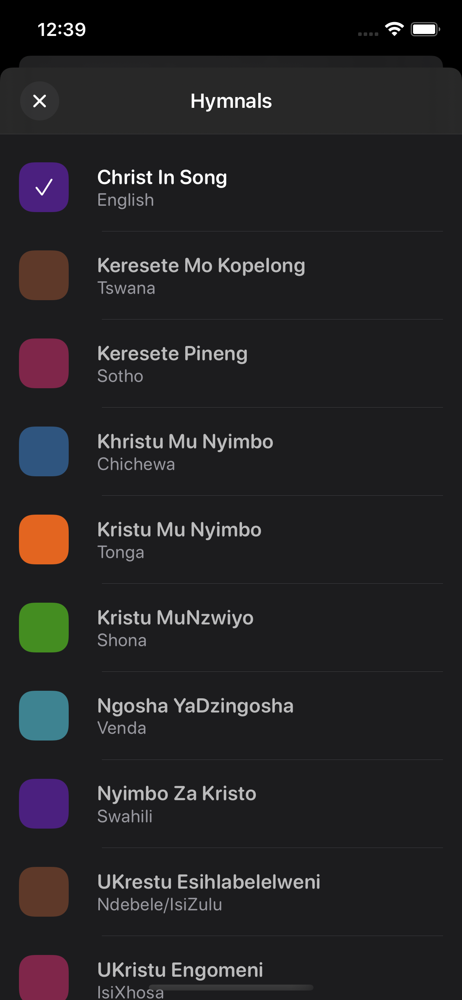
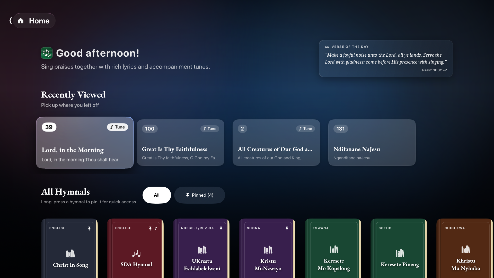
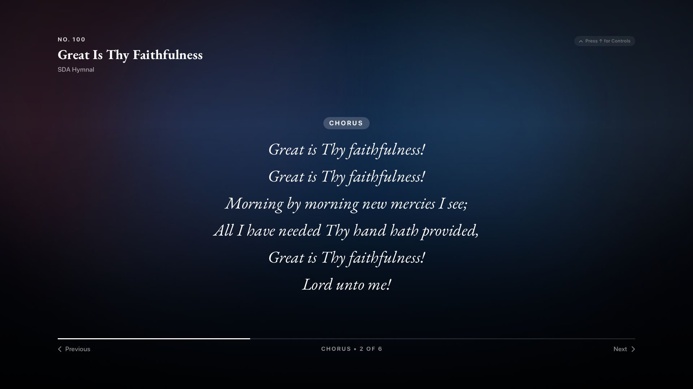
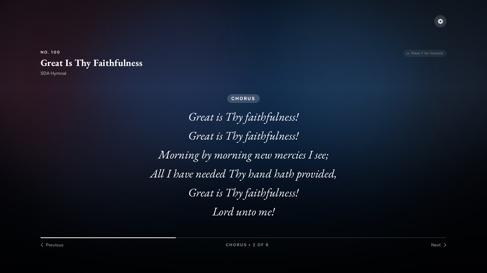

# Christ In Song (iOS & tvOS)

[](https://github.com/TinasheMzondiwa/cis-ios/actions/workflows/build.yml)
[](https://developer.apple.com)
[](https://swift.org)
[](LICENSE)

**Christ In Song** is a modern worship companion app bringing a rich collection of Seventh-day Adventist vernacular and global hymnals to **iPhone, iPad, and Apple TV 4K**.

Written entirely in **SwiftUI** with Swift Concurrency and Core Data.

---

## Screenshots

### iPhone & iPad (iOS 16+)
Fast, touch-optimized hymn browsing with quick number jumping and swipe transitions.

<p align="center">
  
  
  
  
  
</p>

### Apple TV (tvOS 17+)
A 10-foot living room experience tailored for the Siri Remote, featuring ambient worship themes, Top Shelf integration, and verse navigation.

<p align="center">
  
  
  
</p>

---

## Features

- **Multiplatform Architecture**: Native experiences designed specifically for touch (iOS/iPadOS) and the 10-foot Siri Remote focus engine (tvOS).
- **20+ Hymnals & Languages**: English (*Christ in Song*, *SDA Hymnal*), Shona (*Kristu MuNzwiyo*), Ndebele/IsiZulu (*UKrestu Esihlabelelweni*), Chichewa (*Khristu Mu Nyimbo*), Swahili (*Nyimbo Za Kristo*), Tswana, Sotho, Venda, Xhosa, Tsonga, Kikuyu, Dholuo, Kinyarwanda, Portuguese, Spanish, French, Russian, and more.
- **Accompaniment Audio Tunes**: Built-in MIDI synthesizer engine playing accompaniment tracks with auto-cached SoundFonts.
- **Smart Normalized Search**: Punctuation and diacritic-insensitive search (e.g. searching `"come thou fount"` matches *"Come, Thou Fount of Every Blessing"*), instant hymn number jumping, and dedicated number pad search on Apple TV.
- **Worship Collections**: Create and organize custom hymn playlists for church services, choir rehearsals, and family devotions.
- **Ambient Liturgical Themes**: Fluid dark charcoal and pine themes with focus-aware typography designed for comfort during corporate and individual worship.

---

## Hymnals & Languages

Hymn databases and translations are maintained as submodules. See available languages, suggest corrections, or contribute translations at [cis-hymnals](https://github.com/TinasheMzondiwa/cis-hymnals).

---

## Building the Project

### Prerequisites
- macOS 14+ with **Xcode 15.3+**
- [rbenv](https://github.com/rbenv/rbenv) or Ruby 3.x (for CocoaPods on iOS)

### 1. Clone & Fetch Submodules
```bash
git clone https://github.com/TinasheMzondiwa/cis-ios.git
cd cis-ios
./setup_submodules.sh
```

### 2. Building for Apple TV (tvOS)
The **tvOS** scheme is **100% Swift Package Manager (SPM)** based with zero CocoaPods overhead:
```bash
# Open Xcode project directly
open ChristInSong.xcodeproj

# Select the 'tvOS' scheme and choose any Apple TV Simulator
```

### 3. Building for iPhone / iPad (iOS)
The **iOS** scheme uses CocoaPods for additional framework integrations:
```bash
# Install CocoaPods dependencies
bundle install
bundle exec pod install

# Open the workspace
open ChristInSong.xcworkspace

# Select the 'iOS' scheme and run
```

---

## App Store
<a href="https://apps.apple.com/za/app/christ-in-song-multi-language/id1067718185">
  
</a>

---

## Contributions

Contributions are welcome! Please feel free to open GitHub issues, submit typo corrections, or open pull requests.

---

## License

```text
Copyright 2026 Tinashe Mzondiwa

Licensed under the Apache License, Version 2.0 (the "License");
you may not use this file except in compliance with the License.
You may obtain a copy of the License at

   http://www.apache.org/licenses/LICENSE-2.0

Unless required by applicable law or agreed to in writing, software
distributed under the License is distributed on an "AS IS" BASIS,
WITHOUT WARRANTIES OR CONDITIONS OF ANY KIND, either express or implied.
See the License for the specific language governing permissions and
limitations under the License.
```
